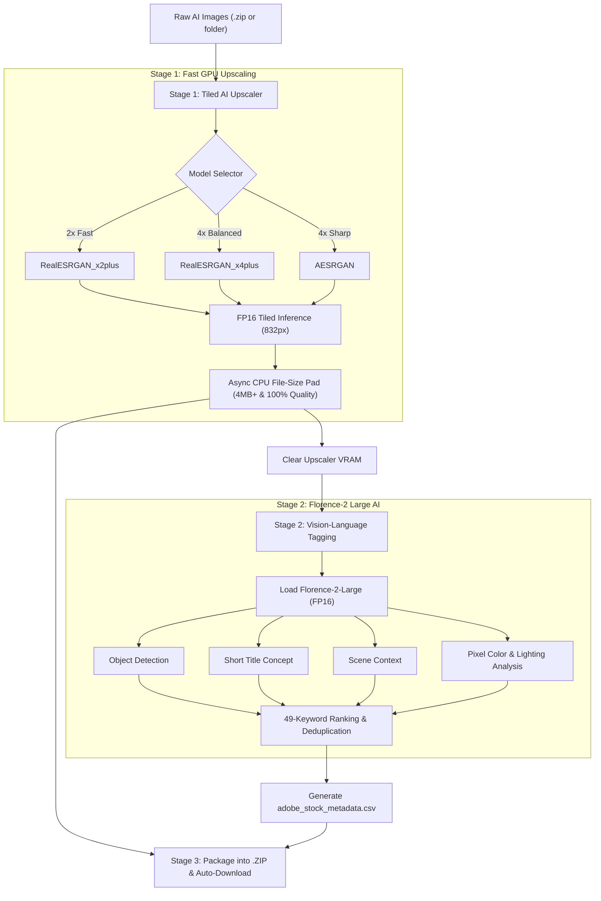
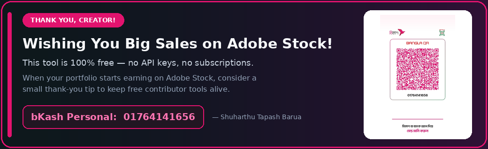

<div align="center">


# ⚡ UTSAV Adobe Stock Contributor (v9) ⚡
### 100% Free AI Image Upscaler + 49-Keyword Adobe Stock Metadata CSV Generator
**A high-performance Google Colab pipeline powered by Real-ESRGAN / AESRGAN & Florence-2 Vision AI**

[](https://colab.research.google.com/github/Shuharthu/Adobe-Ai-Image-Upscaler-and-Metadata-Generation/blob/main/UTSAV_Adobe_Stock_Contributor-v9.ipynb)
[](https://github.com/Shuharthu/Adobe-Ai-Image-Upscaler-and-Metadata-Generation/stargazers)
[](LICENSE)
[](https://pytorch.org/)
[-76B900?style=for-the-badge&logo=nvidia&logoColor=white)](#)
[](https://huggingface.co/florence-community/Florence-2-large)
[](#)

<br/>

**Transform raw generative AI artwork (Midjourney, Stable Diffusion, DALL-E, Flux) into commercial-grade 4MB+ upscaled JPEGs paired with full SEO-optimized 49-keyword Adobe Stock CSV metadata — completely free, no API keys, and runs in 1-click on free Google Colab T4 GPU.**

---

[🚀 Quick Start](#-quick-step-by-step-guide) •
[✨ Key Features](#-key-features) •
[🧠 How the Pipeline Works](#-how-the-pipeline-works) •
[📊 Supported Upscaler Models](#-supported-upscaler-models) •
[🏷️ Metadata Extraction Strategy](#️-metadata-extraction-strategy) •
[📥 Adobe Stock Upload Guide](#-adobe-stock-upload-guide) •
[💬 Support & Author](#-support--connect)

</div>

---

## 🌟 Why This Tool?

Submitting AI-generated assets to stock platforms like **Adobe Stock** typically requires two painful, time-consuming tasks:
1. **Upscaling & Sizing:** Stock platforms reject files that lack fine detail, contain artifact blurring, or fail file-size requirements (< 4MB).
2. **SEO & Tagging:** Writing titles and up to 49 unique, relevant keywords for dozens or hundreds of images takes hours or requires expensive paid API subscriptions.

**UTSAV Adobe Stock Contributor** solves both issues in one integrated Colab notebook:
* **Real-ESRGAN / AESRGAN (FP16 Tiled):** Delivers clean $2\times$, $3\times$, and $4\times$ resolution boosts with zero tile seams and ensures every output image reaches the **4MB+ threshold** with 100% JPEG quality.
* **Microsoft Florence-2 Large:** High-precision zero-shot vision-language model extracts detected objects, descriptive titles, scene attributes, lighting, and composition tokens to populate **up to 49 prioritized keywords**.
* **Ready-to-Submit CSV:** Automatically formats filenames, titles, keywords, category IDs, and releases according to Adobe Stock's official CSV ingest format.

---

## ✨ Key Features

- **⚡ 100% Free & No API Keys Required:** Runs entirely on Google Colab's free T4 GPU tier. No OpenAI, Anthropic, or external paid API tokens needed.
- **🚀 Standalone PyTorch RRDBNet:** Written in pure PyTorch—no broken `basicsr` or legacy C++ build dependencies.
- **🛡️ Adobe Stock Size & Quality Assurance:** Automatically maintains JPEG quality at 100% and guarantees files exceed 4MB so assets are never rejected for low file weight.
- **🧠 Advanced Florence-2 Vision AI:** Employs `<OD>` (Object Detection), `<CAPTION>`, `<MORE_DETAILED_CAPTION>`, and dense visual analysis.
- **🎯 49 Max-Keyword Priority Algorithm:** Tags are hierarchically ranked so the most critical detected objects appear in the top 10 keywords (where Adobe Stock's ranking algorithm assigns the highest weight).
- **🧵 Asynchronous Parallel Execution:** Utilizes Python's `ThreadPoolExecutor` to handle CPU-bound image encoding and disk I/O concurrently while the GPU upscales subsequent images.
- **📦 1-Click ZIP Packaging:** Automatically compresses all processed assets and the formatted `adobe_stock_metadata.csv` into a timestamped `.zip` and prompts instant browser download.
- **💤 Tab-Sleep Prevention:** Includes an integrated keep-alive heartbeat script to prevent Google Colab from disconnecting during long batch runs.

---

## 🧠 How the Pipeline Works



---

## 📖 Quick Step-by-Step Guide

### Step 1: Open in Colab & Turn on GPU
Click the badge below to open the notebook in Google Colab:

[](https://colab.research.google.com/github/Shuharthu/Adobe-Ai-Image-Upscaler-and-Metadata-Generation/blob/main/UTSAV_Adobe_Stock_Contributor-v9.ipynb)

In Google Colab, go to:
> **Runtime** ➔ **Change runtime type** ➔ Select **T4 GPU** ➔ Click **Save**.

### Step 2: Run Setup (Cell 1)
Click the run button (**▶**) on Cell 1. In ~20 seconds, it installs packages and confirms:
```text
PyTorch: 2.x
CUDA GPU available: True
Active GPU: Tesla T4
```

### Step 3: Configure Settings (Cell 2)
Customize your batch parameters via the interactive form:
| Parameter | Default | Description |
|:---|:---:|:---|
| `model_choice` | `RealESRGAN_x2plus` | Choose between 2x speed or 4x high-resolution models. |
| `outscale` | `2` | Scaling factor multiplier ($2\times, 3\times, 4\times$). |
| `output_format` | `jpg` | Preferred export format (`jpg`, `jpeg`, `png`, `webp`). |
| `generate_metadata_csv`| `True` | Automatically generate the 49-keyword Adobe Stock CSV. |
| `default_category` | `""` | Optional Adobe Stock numeric category ID (`1–21`). |
| `download_final_zip` | `True` | Auto-download final bundled archive upon completion. |

### Step 4: Upload & Process
Click **▶** on Cell 2, then click **Choose Files** to upload individual images or a single `.zip` file containing your images. The pipeline will:
1. Upscale all images in FP16 precision.
2. Pad file sizes to $\ge 4\text{ MB}$ at 100% JPEG quality.
3. Load Florence-2 and generate complete metadata.
4. Download `UTSAV_Adobe_Stock_YYYYMMDD_HHMMSS.zip` directly to your browser.

---

## 📊 Supported Upscaler Models

| Model | Native Scale | Best For | Strengths |
|:---|:---:|:---|:---|
| **RealESRGAN_x2plus** | $2\times$ | Fast batch processing, portraits, commercial photos | Ultra-fast execution, natural texture preservation, low VRAM footprint. |
| **RealESRGAN_x4plus** | $4\times$ | General AI art, Midjourney/Stable Diffusion 4K outputs | Rich detail generation, smooth denoising, excellent versatile upscaling. |
| **AESRGAN** | $4\times$ | Anime, digital paintings, vector-style renders | Crisp edges, high sharpness, enhanced line clarity without ringing. |

---

## 🏷️ Metadata Extraction Strategy

Adobe Stock's search ranking algorithm prioritizes relevance and keyword positioning. The Florence-2 tagging engine implements a strict 6-tier prioritization sequence:

```text
Priority 1: Detected Objects (<OD>) ──► Placed in first 10 slots (Highest Adobe SEO weight)
Priority 2: Title Concepts (<CAPTION>) ──► Core thematic keywords
Priority 3: Dense Region Labels ──► Specific foreground & background elements
Priority 4: Detailed Scene Context (<MORE_DETAILED_CAPTION>) ──► Environmental context
Priority 5: Meaningful Bigrams ──► 2-word commercial search phrases (e.g., "golden hour")
Priority 6: Pixel-Verified Visual Attributes ──► Dominant lighting, color palette & composition
```

### Sample CSV Output Structure

| Filename | Title | Keywords | Category | Releases |
|:---|:---|:---|:---:|:---:|
| `futuristic_city_01.jpg` | Futuristic city with glowing neon skyscrapers at dusk | `city, skyscraper, neon light, futuristic, cyberpunk, architecture, night, urban, glowing, skyline, dusk, modern, tower, metropolis, fantasy, building, technology, downtown...` | `3` | |

---

## 📥 Adobe Stock Upload Guide

Once your `.zip` file has downloaded:
1. **Unzip the archive:** Extract `upscaled_images/` and `adobe_stock_metadata.csv`.
2. **Upload Images:** Go to the [Adobe Stock Contributor Portal](https://contributor.stock.adobe.com/) and drag your upscaled images into the upload area.
3. **Upload CSV:** Navigate to **Uploaded Files** ➔ click **Upload CSV** ➔ select `adobe_stock_metadata.csv`.
4. **Final Check:** Check the **"Created using generative AI tools"** box, verify titles and tags, and click **Submit**!

---

## ⚙️ Local Installation (Optional)

If you prefer to run the notebook locally on an NVIDIA GPU workstation:

```bash
# Clone the repository
git clone https://github.com/Shuharthu/Adobe-Ai-Image-Upscaler-and-Metadata-Generation.git
cd Adobe-Ai-Image-Upscaler-and-Metadata-Generation

# Create virtual environment
python -m venv venv
source venv/bin/activate  # On Windows: .\venv\Scripts\activate

# Install dependencies
pip install -r requirements.txt

# Launch Jupyter Notebook or Lab
jupyter notebook UTSAV_Adobe_Stock_Contributor-v9.ipynb
```

---

## 💖 Support & Connect

This project is open-source and free for all stock creators and AI artists. If this pipeline helps boost your Adobe Stock sales or saves you hours of tagging work, consider supporting the development!

<div align="center">



### Support via bKash: `01764141656`

[](https://www.linkedin.com/in/shuharthu-barua-960b98262/)
[](https://github.com/Shuharthu)
[](mailto:shuharthu@gmail.com)

**Created with ❤️ by [Shuharthu Barua](https://github.com/Shuharthu)**

</div>

---

## 📄 License

This project is licensed under the [MIT License](LICENSE) - feel free to use, modify, and distribute for personal and commercial workflows.
